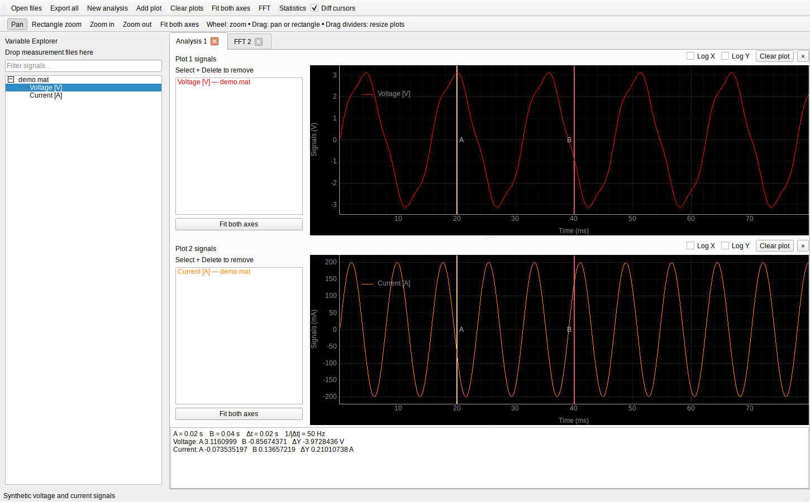

# OpenCaliper

**An open-source data viewer and analyzer.**

OpenCaliper is a Python desktop application for exploring recorded signals in the time and frequency domains. Load measurement files, arrange signals in plots, compare values with differential cursors, calculate FFT spectra and statistics, and convert supported file formats. Its Python API and command-line tools share the same import and analysis functions.



## Documentation

Start with the [step-by-step user guide](docs/USER_GUIDE.md). Contributors can follow the [architecture overview and diagrams](docs/ARCHITECTURE.md), then the [developer walkthrough](docs/DEVELOPMENT.md) for API examples, debugging and extension points. The [documentation index](docs/README.md) links all guides. Generate the [Doxygen API reference](docs/DOXYGEN.md) for linked classes, functions, source listings and architecture drawings.

## Features

- File-based Variable Explorer with filtering and drag-and-drop signal selection.
- Multiple analysis tabs and resizable subplots with linked horizontal axes.
- Shared or separate Y axes, configurable curve colors and plot backgrounds.
- Mouse-wheel and rectangle zoom, panning, and fit-to-data controls.
- Differential cursors for time, frequency and amplitude measurements.
- FFT analysis tabs with drag-and-drop input, selectable source intervals, and logarithmic axes.
- Minimum, maximum, peak-to-peak, mean, RMS and standard deviation.
- GUI, command-line and Python interfaces for supported imports and conversions.

## Easy start on Windows and Linux

Download and extract the source folder, or clone the repository. Keep the complete folder together. Install **Python 3.10 or newer** first; Python 3.12 is a tested choice.

**Windows:** install Python with the Python launcher (`py`) or select **Add Python to PATH** during installation. Double-click **`start_opencaliper.bat`**.

**Linux:** open a terminal in the extracted folder and run:

```bash
./start_opencaliper.sh
```

If the executable permission was lost when extracting a ZIP, use `sh start_opencaliper.sh`. Python must include `pip` and `venv`; on Debian/Ubuntu these are available through `sudo apt install python3 python3-venv python3-pip`. A desktop session and the Qt runtime libraries are required; minimal Linux systems may need additional system libraries.

Both launchers create a local `.venv`, install the application and dependencies on first launch, and open the GUI. First setup requires internet access and may take a few minutes. Later starts reuse the environment; changes to `pyproject.toml` trigger installation again. No environment activation is needed. Use the launcher for your operating system; virtual environments cannot be shared between Windows and Linux.

You can also pass measurement files, or drag a file onto the Windows batch launcher:

```bat
start_opencaliper.bat "C:\Measurements\capture.mat"
```

```bash
./start_opencaliper.sh examples/example.mat
```

### Manual installation and command line

For developers or command-line use on Linux:

```bash
python3 -m venv .venv
source .venv/bin/activate
python -m pip install -e .
opencaliper gui
```

On Windows Command Prompt:

```bat
py -3 -m venv .venv
.venv\Scripts\activate.bat
python -m pip install -e .
opencaliper gui
```

In PowerShell, activate with `.venv\Scripts\Activate.ps1`, or call `.venv\Scripts\python.exe -m opencaliper gui` directly. Command-line analysis and conversion also work without a graphical display.

## Try the example

[example.mat](examples/example.mat) contains four synthetic voltage channels in the usual acquisition MAT layout. Open it directly:

```bash
opencaliper gui examples/example.mat
```

[example.py](examples/example.py) shows exactly how to construct the file, including channel arrays, units and timing metadata. To regenerate it, or create another copy:

```bash
python examples/example.py
python examples/example.py --output another-example.mat
```

The script replaces the selected output file. No measurement hardware is required. Private recordings and local scripts belong in `measFiles/`, which is excluded from Git and source packages.

## Compatible MAT input

The usual acquisition convention stores channels as top-level variables `Channel1_t1`, `Channel2_t1`, and so on. Despite the suffix, these arrays contain **amplitude samples**, not time vectors. OpenCaliper displays them as `Channel1`, `Channel2`, etc.

| Variable | Meaning |
| --- | --- |
| `points` | Number of samples in every channel |
| `xinc` | Sample interval in seconds |
| `xorg`, `xref` | Time origin and reference sample index |
| `ChannelN_t1` | Row or column vector of physical amplitudes, normally float32 |
| `ChannelN_unit` | Unit, for example `VOLT` |
| `ChannelN_yinc`, `ChannelN_offset` | Scaling metadata; applied only to raw unsigned integer samples |
| `date`, `time` | Acquisition timestamp; use `YYYY-MM-DD` and `HH:MM:SS` |
| `samplerate`, `count`, `format` | Additional acquisition metadata |

All channels use the shared time vector:

```python
time = xorg + (np.arange(points) - xref) * xinc
```

For floating-point channel arrays, samples are already in physical units and are not scaled again. Raw `uint8`/`uint16` arrays are also supported with their scaling metadata. `xinc` determines the stored sample interval; `samplerate` does not override it.

To import another file type, convert its physical samples and timing into this layout. See [the MAT format guide](docs/MAT_FORMAT.md) for field details, raw scaling, a converter example and MATLAB code. Both classic MATLAB files and MATLAB-compatible HDF5 files are supported. MAT exports additionally preserve arbitrary names and independent per-channel time vectors in OpenCaliper's interchange layout.

## Using the viewer

1. Open a measurement or drop files into the **Variable Explorer**. Expand a file with **+** to see its channels.
2. Drag channels into a plot. Double-clicking a channel adds it to the first plot of the active tab.
3. Use **Add plot** for another subplot or **New analysis** for an independent time-domain tab.
4. Drag plot dividers to adjust sizes. Use **Pan**, **Rectangle zoom**, the mouse wheel, or **Fit both axes** to navigate.
5. Enable **Diff cursors** and drag A/B to compare values. Cursor positions are shared within a tab.

Select entries beside a plot and press **Delete** to remove those curves. **Clear plot** removes all curves in that subplot; **×** removes the subplot itself. Deleting a file entry in the Explorer unloads its signals from all tabs without deleting the file on disk.

Right-click a signal to change its color or choose a main, separate, or shared Y axis. Right-click empty plot space for signal-color and background-color options. Colors are local to each subplot and retained during that subplot's running session.

### FFT and statistics

**FFT** opens a frequency-domain tab. Drag signals into its plots to calculate spectra; an already selected signal is added when the tab opens. FFT uses a Hann window, removes the mean and displays one-sided peak amplitude in the original signal unit. **Log X** and **Log Y** are enabled by default. Nonpositive coordinates are hidden on logarithmic axes; the underlying samples remain available when switching back to linear display.

If time-domain cursors are enabled when FFT opens, their interval becomes the source time interval. Otherwise, the full signal is used. Edit **Time interval** and click **Recalculate** to update all spectra in that tab. Frequency-domain cursors measure Hz, Δf and interpolated amplitudes independently of the source time interval. Logarithmic amplitude display does not convert values to decibels.

**Statistics** analyzes the selected signal or spectrum, using the current tab's cursor interval when enabled. Time cursors report seconds, Δt, 1/|Δt| and interpolated signal differences. Outside the recorded range, interpolated values are unavailable and shown as NaN. Statistics ignore nonfinite samples; FFT requires at least four finite real samples on a uniformly spaced time axis.

## Command line

```bash
opencaliper info measurement.mat
opencaliper stats measurement.mat --signal 0 --start 0 --stop 0.5
opencaliper fft measurement.mat spectrum.csv --signal 0
opencaliper convert measurement.mat measurement.mf4
opencaliper convert measurement.mat measurement.raw
opencaliper convert measurement.mat measurement.wvf
opencaliper convert recording.mf4 converted.mat
```

`--signal` is the zero-based channel index printed by `info`; interval values are seconds. `python -m opencaliper` provides the same commands. `mat2raw input.mat output.raw` is a shortcut for RAW conversion. Converters refuse to overwrite files unless `--overwrite` is supplied; FFT CSV output also refuses existing files.

## File support

| File type | Import | Export |
| --- | --- | --- |
| MATLAB `.mat` (documented acquisition and OpenCaliper layouts) | Yes | Yes |
| MDF `.mdf` / `.mf4` | Yes | Yes |
| Keysight `.bin` | Yes | No |
| Yokogawa `.wvf` + companion `.hdr` | Yes | Yes |
| LTspice `.raw` | Yes | Yes |

Readers support numeric waveform data within these formats: Keysight normal/average float32 time waveforms, Yokogawa single-block IS2 data, MDF numeric scalar channels, and LTspice time-domain recordings with one plot per file. Compatibility depends on the file's encoding, not only its extension.

### Current limits

Recordings are loaded into memory. Imports run in background threads, while FFT calculation and export currently run on the interface thread. Large recordings can take time and memory. Analysis tabs are kept for the current session only.

RAW and WVF export require real channels on identical, uniformly spaced time axes. RAW export requires finite voltage/current data and starts time at zero; its header records the original time origin. WVF output uses int16 quantization. Conversion does not preserve all device-specific metadata. Text, structured and bus-decoding channels are outside the current MDF import scope. See [the format guide](docs/MAT_FORMAT.md) for additional input limits.

## Development

```bash
python -m pip install -e '.[dev]'
python -m unittest discover -s tests -v
python -m build
```

To generate the API reference and architecture drawings, install Doxygen and Graphviz, then run from the repository root:

```bash
doxygen Doxyfile
```

Open `docs-api/html/index.html` in your browser. These documentation tools are optional and are not installed by the application launchers. See the [Doxygen guide](docs/DOXYGEN.md) for Linux and Windows setup. The documentation workflow also provides a downloadable HTML artifact in GitHub Actions; no documentation website is published automatically.

Tests use generated data and temporary files. Optional local capture fixtures can be supplied with `OPENCALIPER_TEST_DATA_DIR`; see [CONTRIBUTING.md](CONTRIBUTING.md). The CI workflow runs the automated tests and builds release artifacts.

## License

OpenCaliper is distributed under **GPL-3.0-only**. See [LICENSE](LICENSE), [NOTICE](NOTICE) and [THIRD_PARTY_NOTICES.md](THIRD_PARTY_NOTICES.md). Dependencies retain their own licenses. The software is provided without warranty as described in the license.
