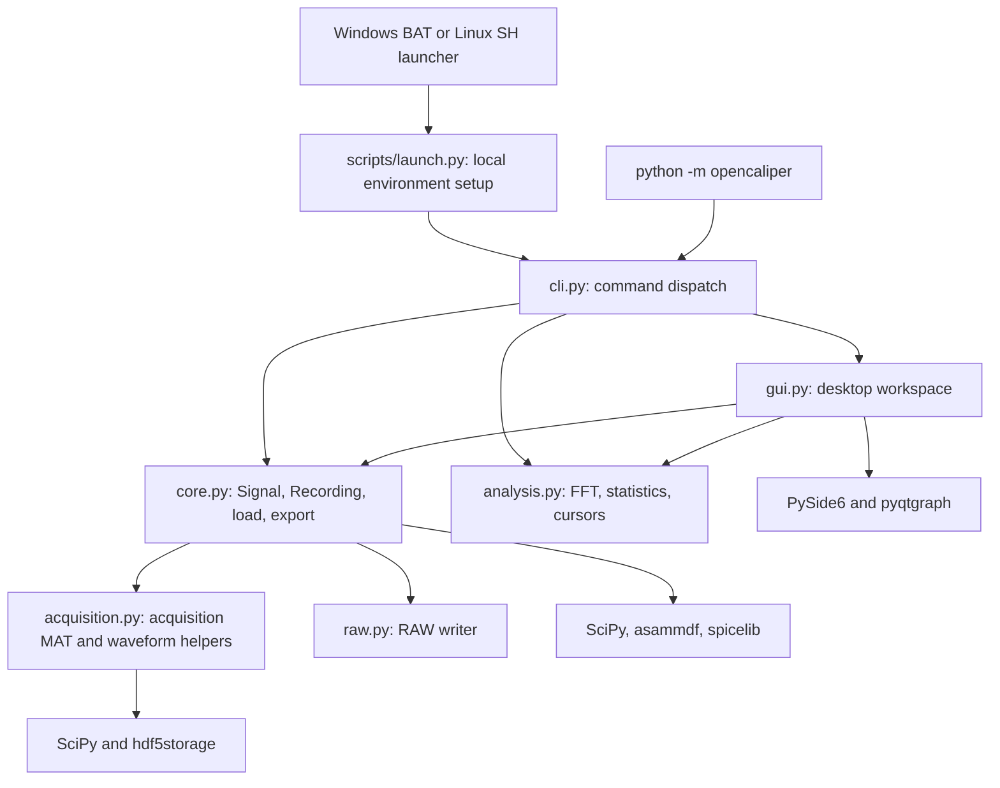
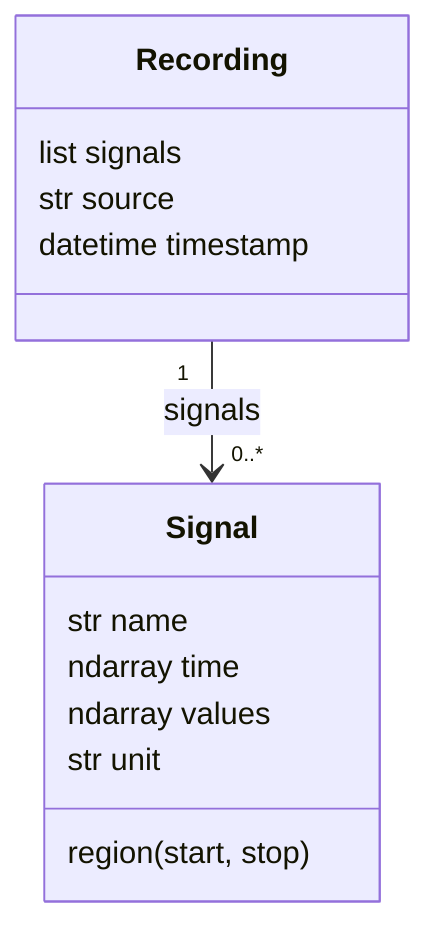

# Architecture

OpenCaliper is a desktop application with a reusable Python data and analysis layer. The GUI and command line call the same functions for reading, analyzing and exporting measurements. This document describes the code as it exists today; it is not a proposal for a future architecture.

## Navigate the API and drawings

For linked class/function documentation and source listings, build the [Doxygen reference](DOXYGEN.md) and open `docs-api/html/index.html`. Its **Architecture drawings** page shows component dependencies, runtime ownership and the loading/display flow. This guide supplies the longer explanation and a loading sequence diagram.

Mermaid diagrams below render in GitHub Markdown. The Doxygen drawings use Graphviz and are maintained in [architecture.dox](doxygen/architecture.dox); the landing page is [main.dox](doxygen/main.dox). Update both diagram sets when shared relationships change. Automatic class graphs supplement the curated views, but cannot fully infer Python runtime ownership.

## Component overview

Arrows below mean “calls or imports.” Format readers convert files into a common in-memory model before the GUI or analysis functions use them.



| Source | Responsibility | Read when changing |
| --- | --- | --- |
| [core.py](../opencaliper/core.py) | Public data model; extension-based import/export dispatch; several format readers | File support, validation or common data representation |
| [analysis.py](../opencaliper/analysis.py) | Numerical operations on full source arrays | FFT normalization, statistics or interpolation |
| [gui.py](../opencaliper/gui.py) | Qt widgets, loading workers, session state, plotting and interactions | Tabs, curves, axes, menus or cursor behavior |
| [cli.py](../opencaliper/cli.py) | Argument parsing and calls into core/analysis | Commands and options |
| [acquisition.py](../opencaliper/acquisition.py) | Acquisition MAT decoding, physical scaling, timestamp parsing, waveform quantization/writing | Acquisition convention or waveform export |
| [raw.py](../opencaliper/raw.py) | Binary transient RAW output | RAW headers, precision or sample layout |
| [launch.py](../scripts/launch.py) | Creates `.venv`, installs the checkout and starts the GUI | First-run setup |
| [pyproject.toml](../pyproject.toml) | Dependencies, package metadata and console entry points | Installation or packaging |

Format dispatch currently uses conditionals inside `load()` and `export()`. There is no plugin registry. `gui.py` contains several classes in one module; the table below helps locate the relevant part without assuming each widget has its own file.

## Data model and contracts

`Signal(name, time, values, unit)` represents one channel. `Recording(signals, source, timestamp)` groups channels originating from a file or constructed in Python. `source` is a path string used for identification; `timestamp` is separate acquisition metadata.



`Signal.__post_init__()` flattens the arrays, converts the time axis to floating point, and rejects empty arrays, unequal lengths, nonnumeric samples, nonfinite timestamps and decreasing time. Equal adjacent timestamps are accepted by the model. Operations that require strictly positive, uniform intervals check that themselves. Different channels may have different time axes.

`Signal.region()` selects existing samples between bounds, including a sample exactly on either bound. It sorts two supplied bounds, uses `searchsorted`, and does not insert interpolated boundary samples. Cursor interpolation is a separate operation.

Values can be complex or contain NaN/Inf in the general model. Individual operations impose stricter requirements. Importers must return physical amplitudes and timestamps in seconds. Keep the source data unchanged during plotting; display configuration belongs to the plot or analysis page. The dataclasses and arrays are mutable, so this separation is a programming convention rather than enforced immutability.

FFT plots reuse `Signal`: its `time` array holds **frequency in Hz** there. The page's `kind` distinguishes a time trace from a spectrum. This is an implementation compromise to remember when extending code that labels or interprets an axis.

## Loading a recording

```mermaid
sequenceDiagram
    actor User
    participant W as Window (GUI thread)
    participant L as Loader (worker thread)
    participant C as core.load
    participant E as Explorer and signal registry
    User->>W: Open or drop a file
    W->>L: open_path creates and starts worker
    L->>C: load(path)
    C-->>L: Recording with physical signals
    L-->>W: loaded(Recording) Qt signal
    W->>E: Register file ID and signal IDs; add tree items
    L-->>W: finished signal; release worker
```

On failure, `Loader` emits `failed` with an error message instead of a recording. Widget updates happen through the main-window handlers on the GUI thread. `Window.workers` retains workers while imports run; closing the window is refused until imports finish. There is no import cancellation mechanism.

For acquisition MAT data, `core.load()` calls `read_measurement(..., quantize_output=False)`. This avoids quantizing imported physical values to the waveform export representation. The time vector is reconstructed from sampling metadata. See [MAT format](MAT_FORMAT.md) for the exact fields and scaling formula.

## GUI state and ownership

| Class/state | Owns or manages |
| --- | --- |
| `Window` | Shared explorer, all tabs, loading workers, file and signal registries |
| `MeasurementExplorer` | File/channel tree; file-drop and unload requests; drag payload creation |
| `SignalList` | Per-plot signal sidebar; selection and removal requests |
| `AnalysisPage` | One tab's plots, cursor positions/visibility, navigation mode and FFT source interval |
| `Plot` | Curves, displayed signals, colors, axis assignments, additional Y views and log settings |
| `SignalViewBox` | Plot context-menu behavior |
| `Loader` | A single asynchronous file read |

`Window.signals` maps monotonically assigned integer IDs to source `Signal` objects. `signal_items` maps these IDs to explorer items. `files` maps file IDs to a tree root and its signal IDs. IDs are session-local references, not channel names or persistent file identifiers. Identical channel names from different recordings therefore remain distinct.

A plot uses these same IDs as keys in `curves`, `display_signals`, `signal_colors` and `signal_axes`. For a time page, `display_signals` references source signals; for FFT pages, it contains transformed signals. Several plots can display the same source independently.

Drag-and-drop sends JSON-encoded signal IDs using the internal MIME type `application/x-opencaliper-signals`. It does not serialize measurement arrays. `Plot` emits the dropped ID and `Window.add_signal()` resolves the source and creates the curve and sidebar item. File drops instead use local file URLs and start an import.

Removing a curve changes that plot. Unloading a file removes its IDs and curves from **all** tabs, then removes the explorer entry. Neither operation deletes the file on disk. Closing a tab removes its view state; the shared source registry remains available to other tabs. Layouts are not saved between sessions.

## Axes, display and cursors

The main `ViewBox` provides the default Y axis. Additional Y axes pair a right-side `AxisItem` with another `ViewBox`; X coordinates remain linked. `Plot.assign_axis()` reparents curves, and `prune_axes()` removes unused axes. Main-view navigation forwards normalized Y-range changes to additional views.

Within a page, X-range changes are synchronized across plots. Cursor positions also belong to the page. Guard flags prevent signal callbacks from recursively updating one another. Each plot converts physical cursor coordinates to/from logarithmic scene coordinates through `x_to_scene()` and `x_from_scene()`. Cursors and readouts must continue to use physical seconds or Hz, even when the scene uses log10 coordinates.

pyqtgraph may downsample and clip curves for rendering. Numerical functions receive the original or transformed arrays, never the rendered pixels or display-decimated curve. Log settings affect display, not the underlying amplitudes; logarithmic Y is not a dB conversion.

## FFT, statistics and export

`analysis.fft()` requires at least four finite real samples with positive, approximately uniform spacing. It removes the mean, applies a Hann window and returns a one-sided peak-amplitude spectrum. Window-sum normalization and endpoint adjustments prevent doubling the DC and even-length Nyquist bins. This is not a power spectral density.

An FFT page stores its **source time interval** separately from its frequency cursor positions. `transformed_signal()` computes spectra when signals are added. `recalculate_fft()` computes and validates every requested result before replacing displayed data, so an invalid signal does not leave a partially updated set of spectra. FFT and export currently execute on the GUI thread and can block interaction for large inputs.

`statistics()` operates on the selected sample interval, ignores nonfinite values and uses magnitudes for complex input. Its standard deviation uses NumPy's population convention (`ddof=0`). `cursor_values()` uses linear interpolation and returns NaN outside the recorded range; interpolation of spectra is between bins, not an estimate of extra spectral resolution.

GUI **Export all** builds a new `Recording` from all loaded source signals, not only visible curves or FFT spectra. It currently uses the model's default timestamp rather than retaining a particular input file's timestamp. Python and CLI callers exporting an existing `Recording` can preserve that recording's timestamp. MAT output uses the explicit per-channel interchange layout. RAW and WVF require identical uniform axes and real data; WVF quantizes amplitudes, and RAW starts time at zero while recording the original origin in its header.

## Boundaries and current limitations

All recordings are loaded into memory. There is no streaming database, backend server, saved workspace format, automatic resampling or general unit-conversion layer. Core and analysis can run without creating a Qt application, although the standard installation includes GUI dependencies. Format-specific libraries are imported when their format is used.

The analysis functions are small and isolated; the GUI controller is comparatively concentrated in `Window`. If GUI complexity grows, extracting state and actions into separate modules is a possible future change. It is not a prerequisite for understanding or contributing to the current code.
